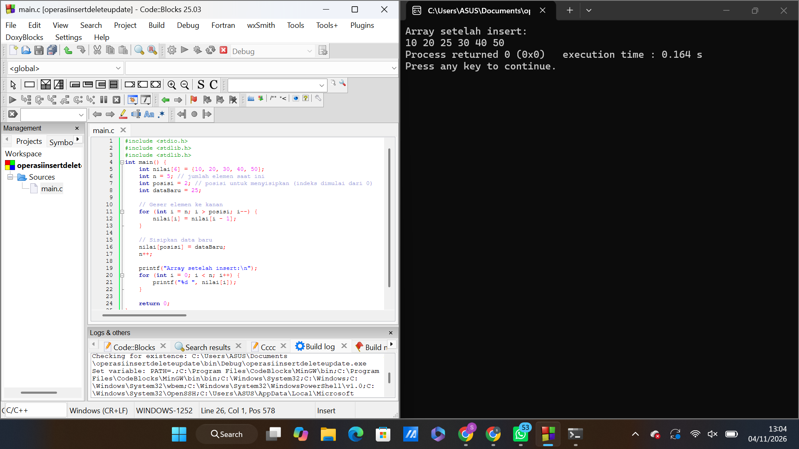
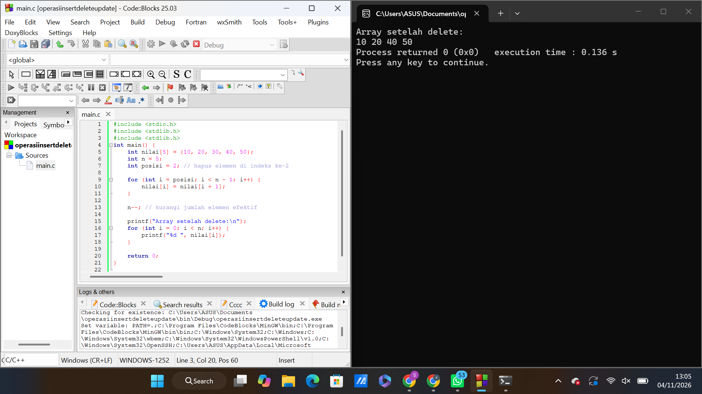
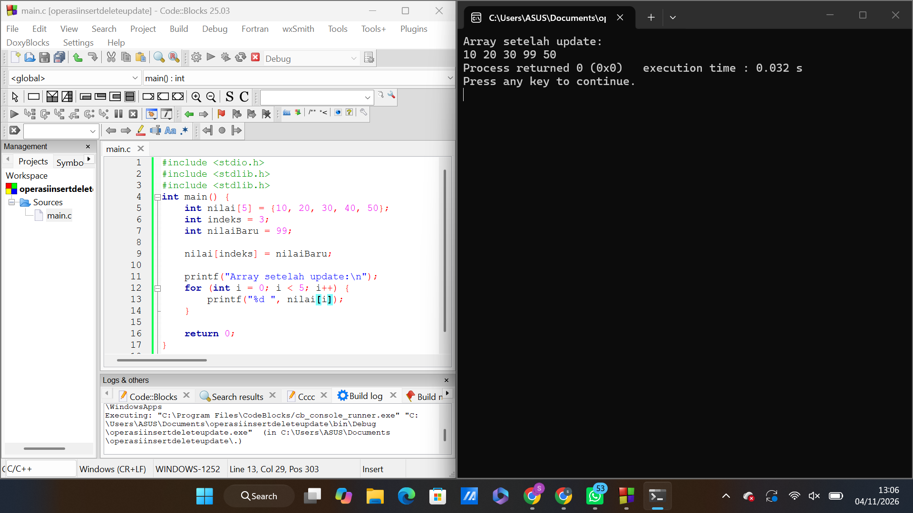

# 📌 OPERASI INSERT, DELETE, DAN UPDATE PADA ARRAY

## 👩‍💻 Deskripsi
Program ini merupakan implementasi operasi dasar Array menggunakan bahasa pemrograman C. Terdapat tiga operasi yang diterapkan, yaitu Insert untuk menambahkan data, Delete untuk menghapus data, dan Update untuk mengubah data pada posisi tertentu.

Program dibuat menggunakan aplikasi **Code::Blocks 25.03** sebagai media penulisan dan pengujian kode.

## 🎯 Tujuan
- Memahami penggunaan Array dalam bahasa C.
- Mempelajari proses penambahan dan penghapusan data.
- Memahami cara memperbarui nilai pada elemen Array.
- Mengetahui penggunaan indeks dan perulangan dalam pengolahan data.

## 1. INSERT (Penambahan Data)

Insert merupakan proses memasukkan elemen baru ke dalam Array pada indeks tertentu.

**Data awal:** `10 20 30 40 50`

**Data baru:** `25` (indeks ke-2)

**Hasil program:**
```text
10 20 25 30 40 50
```

### Dokumentasi
**Screenshot kode dan hasil running Insert:**



## 2. DELETE (Penghapusan Data)

Delete merupakan proses menghapus elemen tertentu dari Array. Elemen setelahnya akan bergeser ke kiri.

**Data awal:** `10 20 30 40 50`

**Data yang dihapus:** `30` (indeks ke-2)

**Hasil program:**
```text
10 20 40 50
```

### Dokumentasi
**Screenshot kode dan hasil running Delete:**



## 3. UPDATE (Perubahan Data)

Update merupakan proses mengganti nilai elemen Array dengan nilai baru pada indeks yang telah ditentukan.

**Data awal:** `10 20 30 40 50`

**Perubahan:** `40` menjadi `99` (indeks ke-3)

**Hasil program:**
```text
10 20 30 99 50
```

### Dokumentasi
**Screenshot kode dan hasil running Update:**



## 📊 Kesimpulan

Berdasarkan percobaan yang dilakukan, operasi Insert, Delete, dan Update berhasil diterapkan pada Array menggunakan bahasa C. Setiap operasi memiliki fungsi yang berbeda, tetapi semuanya digunakan untuk mengelola dan memanipulasi data sesuai kebutuhan.

## 🛠️ Tools yang Digunakan
- Bahasa pemrograman C
- Code::Blocks 25.03
- GNU GCC Compiler
- GitHub

## 📂 Struktur File

```text
operasi-array/
│
├── README.md
├── insert.c
├── delete.c
├── update.c
│
└── images/
    ├── insert.png
    ├── delete.png
    └── update.png
```

---
**Terima kasih telah mengunjungi repository ini!**
